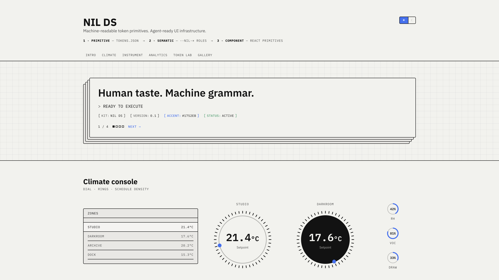
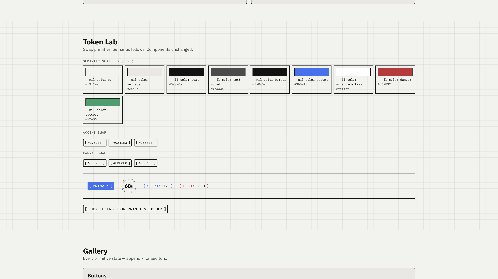

> **NIL DS** — public kit by [Jennifer Hull](https://jenniferhull.co.za). Live demo: [nil-ds.vercel.app](https://nil-ds.vercel.app).
> Architecture: see `ARCHITECTURE.md`. North star (`@nilds/*`): see `PLAN.md`.

# NIL DS

Token + primitive kit — brutalist CLI lineage from `mothership-stable`, plus
**new instrument primitives** (Dial, Stack, Panel, etc.). Primitive → semantic →
component architecture with agent-readable `tokens.json` + `registry.json`.

**Live demo:** [nil-ds.vercel.app](https://nil-ds.vercel.app)



*Intro + climate: composed showroom, not a flat catalog.*



*Token Lab: swap a primitive; semantic `--nil-*` roles update; components stay put.*

## Primitives (v0.1)

| Component | Notes |
|-----------|-------|
| `Button`, `Badge`, `Card`, `Grid`, `Input`, `Heading`, `Text`, `Divider` | Core + mothership extracts |
| `Meta`, `ThemeToggle`, `Lightbox` | CLI extracts |
| `Panel`, `Stack`, `Prompt`, `Readout` | Instrument shells |
| `Dial`, `Ring` | Circular gauges |
| `Toggle`, `DataRow`, `TabStrip` | Schedule / density UI |

## Tokens

- Source: `src/tokens/tokens.json` (edit this)
- CSS: `src/tokens/tokens.json` → `npm run tokens:build` → `tokens.css`
- Values: see `primitive.color` in `tokens.json`. Do not restate hexes here.
- Namespace: `--nil-*` (consumer) · `--nil-primitive-*` (raw)

## Quick start

```bash
npm install
npm run dev          # showroom localhost:5173
npm run tokens:build # regenerate CSS from JSON
npm run typecheck    # validate tokens + tsc
npm run build:demo   # dist-demo/
```

## Consumer wiring

See **[APPLY.md](APPLY.md)** — link, CSS import order, Tailwind `@theme`, ui wrappers.

## Agent / design ops

- **[AGENTS.md](AGENTS.md)** — token rules, composition guide
- **[registry.json](registry.json)** — component manifest
- **[FIGMA.md](FIGMA.md)** — variables sync path
- `src/core/tailwind-theme.css` — ready Tailwind v4 alias block

## DESIGN.md

[DESIGN.md](DESIGN.md) describes NIL DS in Google Labs' open [DESIGN.md format](https://github.com/google-labs-code/design.md) (spec version `alpha`), so a coding agent or a tool that reads the format gets the whole system in one file.

It's generated, not written by hand. Every value comes from `src/tokens/tokens.json`, and the rationale prose lives in `design-md/`. Edit those, then rebuild and lint:

```bash
npm run tokens:build          # regenerates tokens.css and DESIGN.md
npx designmd lint DESIGN.md   # the format's own linter
```

`npm run tokens:validate` fails if `DESIGN.md` has drifted from its sources, and it runs the linter too. Lint errors fail it. Warnings are printed and don't, so the contrast findings show up on every run. The linter isn't part of `build:demo`, so it can't block a deploy.

Honest state: the format is at spec version `alpha`, and it has no concept of themes, motion or borders. How NIL DS handles each is written up in the file itself and in `PLAN.md`.

## Showroom

Five composed scenes (Intro, Climate, Instrument, Analytics, Token Lab) + Gallery appendix — not a flat component catalog.

## Status

- [x] v0.1 proper elevation — instrument primitives + Token Lab + build pipeline
- [x] Figma path documented (`FIGMA.md`)
- [x] Vite showroom (Storybook parked)
- [ ] `@nilds/*` publish / monorepo split when earned
